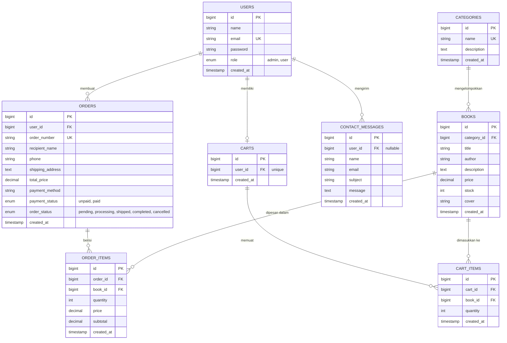

# PANDUAN LENGKAP & LAPORAN TEKNIS MEMAHAMI PROJECT
# SUDUTBACA – ONLINE BOOKSTORE
### Didesain Sebagai Media Pembelajaran & Persiapan Asesmen Sertifikasi BNSP Skema Junior Web Developer

> **Identitas Visual**: Warm Green & Cream (Forest Green `#315C46`, Warm Cream `#F8F5EC`, Sage Green `#789477`, Soft Beige `#E8DCC5`, Dark Brown `#463D32`)  
> **Tagline**: *"Temukan Bacaan Favoritmu."*  
> **Arsitektur**: Decoupled Single Page Application (ReactJS + Vite) & RESTful API (PHP Laravel 10) + MySQL

---

## DAFTAR ISI LAPORAN

1. [Cover dan Identitas Project](#1-cover-dan-identitas-project)
2. [Pendahuluan & Cara Menggunakan Panduan Ini](#2-pendahuluan--cara-menggunakan-panduan-ini)
3. [Deskripsi Aplikasi SudutBaca](#3-deskripsi-aplikasi-sudutbaca)
4. [Tujuan dan Ruang Lingkup Project](#4-tujuan-dan-ruang-lingkup-project)
5. [Teknologi yang Digunakan & Alasan Pemilihannya](#5-teknologi-yang-digunakan--alasan-pemilihannya)
6. [Arsitektur Aplikasi & Alur Komunikasi Client-Server](#6-arsitektur-aplikasi--alur-komunikasi-client-server)
7. [Bedah Struktur Folder dan Fungsi Setiap File](#7-bedah-struktur-folder-dan-fungsi-setiap-file)
8. [Penjelasan Mendalam Frontend (ReactJS + Vite)](#8-penjelasan-mendalam-frontend-reactjs--vite)
9. [Penjelasan Mendalam Backend (Laravel 10 REST API)](#9-penjelasan-mendalam-backend-laravel-10-rest-api)
10. [Dokumentasi Basis Data MySQL & Kamus Data](#10-dokumentasi-basis-data-mysql--kamus-data)
11. [Alur Kerja Seluruh Fitur Aplikasi (Step-by-Step)](#11-alur-kerja-seluruh-fitur-aplikasi-step-by-step)
12. [Analisis Potongan Kode Nyata (Code Walkthrough)](#12-analisis-potongan-kode-nyata-code-walkthrough)
13. [Pemetaan 6 Unit Kompetensi BNSP Junior Web Developer](#13-pemetaan-6-unit-kompetensi-bnsp-junior-web-developer)
14. [Panduan Instalasi & Menjalankan Aplikasi dari Awal](#14-panduan-instalasi--menjalankan-aplikasi-dari-awal)
15. [Skenario Demonstrasi Terstruktur di Hadapan Asesor](#15-skenario-demonstrasi-terstruktur-di-hadapan-asesor)
16. [Bank Latihan 35 Tanya Jawab Wawancara Asesmen](#16-bank-latihan-35-tanya-jawab-wawancara-asesmen)
17. [Kesimpulan dan Saran Pengembangan Lanjutan](#17-kesimpulan-dan-saran-pengembangan-lanjutan)
18. [Glosarium Istilah Pemrograman Web](#18-glosarium-istilah-pemrograman-web)

---

## 1. COVER DAN IDENTITAS PROJECT

* **Nama Proyek**: SudutBaca – Online Bookstore
* **Jenis Aplikasi**: Toko Buku Daring Berbasis Web (E-Commerce Web Application)
* **Tagline**: *"Temukan Bacaan Favoritmu."*
* **Skema Uji Kompetensi**: Junior Web Developer (Materi Uji Kompetensi / MUK BNSP)
* **Pengembang**: Peserta Sertifikasi BNSP Junior Web Developer
* **Lingkungan Pengembangan**:
  * Sistem Operasi: Windows
  * Web Server Local: PHP 8.2 Built-in CLI & Apache/MySQL (XAMPP)
  * Framework Backend: Laravel 10.x LTS
  * Framework Frontend: ReactJS 18.x + Vite 5/6
  * Basis Data: MySQL (Database `bookspace_db`)

---

## 2. PENDAHULUAN & CARA MENGGUNAKAN PANDUAN INI

Selamat datang di buku panduan teknis **SudutBaca**. Dokumen ini ditulis secara khusus sebagai **jembatan belajar** bagi Anda yang sedang mempersiapkan diri menghadapi Asesmen Uji Kompetensi BNSP Junior Web Developer.

### Mengapa Dokumen Ini Penting?
Banyak calon pengembang web merasa gugup saat menghadapi asesor bukan karena aplikasinya tidak berfungsi, melainkan karena **kurang memahami apa yang terjadi di balik layar (behind the scenes)**. Ketika asesor bertanya:
* *"Mengapa Anda meletakkan baris kode ini di sini?"*
* *"Bagaimana alur tombol ini bisa menyimpan data ke MySQL?"*
* *"Apa bukti Anda menerapkan pemrograman terstruktur?"*

Buku panduan ini dirancang untuk menjawab seluruh keraguan tersebut dengan bahasa yang membumi, analogi sehari-hari, dan contoh kode nyata yang ada di dalam repositori Anda.

---

## 3. DESKRIPSI APLIKASI SUDUTBACA

**SudutBaca** adalah platform toko buku online modern yang mengusung tema kenyamanan dan ketenangan dalam membaca. Berbeda dengan marketplace raksasa yang padat dan penuh distraksi, SudutBaca dirancang dengan filosofi **"Warm, Natural, Minimalist, dan Elegant"**.

Karakteristik utama SudutBaca:
1. **Pemisahan Peran Tegas**: Tersedia dua jenis pengalaman antarmuka:
   * **Antarmuka Pelanggan (Customer)**: Berfokus pada kemudahan menemukan buku, eksplorasi sinopsis, keranjang belanja dinamis, proses checkout ringkas, dan riwayat pesanan.
   * **Antarmuka Administrator**: Berfokus pada tata kelola data (CRUD Buku, Kategori, Monitoring Pelanggan, Status Pesanan, dan Pesan Masuk).
2. **Payment at Delivery (COD)**: Sesuai kisi-kisi MUK BNSP, metode pembayaran difokuskan pada pembayaran tunai saat buku tiba di alamat pelanggan tanpa ketergantungan *payment gateway* pihak ketiga yang rentan gagal koneksi saat ujian.
3. **Integritas Stok Transaksional**: Menggunakan transaksi basis data (*Database Transaction*) agar stok buku tidak pernah berkurang jika proses pemesanan gagal di tengah jalan.

---

## 4. TUJUAN DAN RUANG LINGKUP PROJECT

### 4.1 Tujuan Project
1. Memenuhi seluruh persyaratan kelulusan unit kompetensi pada skema **Junior Web Developer (JWD)** BNSP.
2. Membangun website toko buku yang memiliki fungsi nyata (bukan sekadar tampilan/mockup statis).
3. Mengasah pemahaman arsitektur pemisahan *Client-Server* (Frontend SPA dan Backend REST API).
4. Menyediakan sistem inventaris buku yang terhubung langsung ke basis data relasional MySQL.

### 4.2 Batasan Masalah (Scope Limitation)
Agar proyek tetap terarah, mudah dipresentasikan, dan tidak berlebihan (*over-engineering*):
* Metode pembayaran adalah **Payment at Delivery**.
* Ongkos kirim diset secara flat (Gratis Ongkir) untuk memusatkan evaluasi pada integritas logika checkout.
* Otentikasi sesi menggunakan token API (*Laravel Sanctum*) yang disimpan di `localStorage` peramban.
* Peran pengguna dibagi secara tegas menjadi dua: `admin` dan `user`.

---

## 5. TEKNOLOGI YANG DIGUNAKAN & ALASAN PEMILIHANNYA

| Komponen | Teknologi | Versi | Alasan Pemilihan & Manfaatnya |
|---|---|---|---|
| **Frontend Framework** | ReactJS | 18.x | Menggunakan konsep komponen (*Component-based Architecture*). Halaman tidak perlu me-refresh seluruh layar saat berpindah halaman (*Single Page Application*), menghasilkan pengalaman pengguna yang mulus. |
| **Frontend Build Tool** | Vite | 5/6 | Sangat cepat dalam proses *Hot Module Replacement (HMR)* dan kompilasi modul dibandingkan bundler lawas seperti Webpack. |
| **Client Routing** | React Router Dom | 6.x | Standar industri untuk menangani navigasi antarhalaman di sisi peramban (*client-side routing*) tanpa memicu request HTTP reload ke server. |
| **HTTP Client** | Axios | 1.x | Memudahkan komunikasi HTTP request (GET, POST, PUT, PATCH, DELETE) dengan fitur *interceptors* untuk menyisipkan Bearer Token secara otomatis. |
| **Styling** | Modern Vanilla CSS | CSS3 | Menggunakan CSS Variables (Custom Properties) dengan palet Warm Green & Cream. Sangat ringan, tidak bergantung pada library berat (seperti Tailwind/Bootstrap), dan sangat mudah dijelaskan baris demi baris kepada penguji. |
| **Ikon Antarmuka** | Lucide React | Modern | Koleksi ikon SVG yang konsisten, berukuran ringan, dan mudah dikustomisasi warna serta ukurannya. |
| **Backend Framework** | PHP Laravel | 10.x LTS | Framework PHP nomor satu dunia yang mengadopsi pola MVC (*Model-View-Controller*), dilengkapi ORM Eloquent, migrasi basis data otomatis, dan keamanan bawaan (*CSRF, SQL Injection prevention, Bcrypt hashing*). |
| **Autentikasi API** | Laravel Sanctum | 3.x | Sistem otentikasi token sederhana yang sangat ringan untuk mengamankan REST API bagi Single Page Application (SPA). |
| **Basis Data** | MySQL (MariaDB) | 10.x / 8.x | Database relasional standar industri yang stabil, mendukung Foreign Key, ACID Transaction, dan integrasi mulus dengan Laravel. |

---

## 6. ARSITEKTUR APLIKASI & ALUR KOMUNIKASI CLIENT-SERVER

Aplikasi SudutBaca menggunakan arsitektur **Decoupled Client-Server (Pemisahan Klien dan Server)**:

```
[ Frontend: ReactJS + Vite ] 
      │ (Port 5173)
      │
      │ 1. Kirim HTTP Request (JSON) + Header: Authorization Bearer <Token>
      ▼
[ Web Server API: Laravel 10 ] 
      │ (Port 8000)
      ├─ routes/api.php        (Routing rute endpoint)
      ├─ CheckRole Middleware  (Pengecekan hak akses admin/user)
      ├─ Form Request/Validate (Validasi data masukan)
      ├─ Controller            (Pengendali logika bisnis)
      ├─ DB Transaction / ORM  (Manipulasi data relasional)
      ▼
[ Database: MySQL bookspace_db ]
      │ (Port 3306)
      ▼
[ Response JSON: { success, message, data } ]
      │
      ▼
[ React State Update & UI Render ]
```

### Penjelasan Alur Request Komunikasi:
1. **Aksi Pengguna**: Pengguna mengklik tombol di antarmuka React (misalnya tombol "Konfirmasi & Buat Pesanan" di halaman Checkout).
2. **HTTP Request**: Axios menangkap data form, menyematkan Bearer Token dari `localStorage` jika pengguna sudah login, lalu mengirimkan request HTTP POST ke `http://127.0.0.1:8000/api/checkout`.
3. **Route & Middleware Backend**: Laravel menerima request di `routes/api.php`. Middleware `auth:sanctum` memverifikasi token. Jika token valid, request diteruskan ke `OrderController@checkout`.
4. **Validasi & Logika**: Controller memeriksa ketersediaan stok buku di MySQL dalam sebuah **Database Transaction**.
5. **Database Operation**: Stok buku dikurangi di tabel `books`, order baru dibuat di tabel `orders`, rincian buku dicatat di `order_items`, dan keranjang belanja dikosongkan.
6. **HTTP Response**: Server mengirimkan jawaban berformat JSON standar: `{ "success": true, "message": "...", "data": { ... } }` dengan kode status HTTP 201 (Created).
7. **Pembaruan State Frontend**: React menerima JSON tersebut, memperbarui state keranjang (menjadi 0 item), dan memindahkan pengguna ke halaman rincian pesanan.

---

## 7. BEDAH STRUKTUR FOLDER DAN FUNGSI SETIAP FILE

Mari kita bedah struktur folder dan file nyata yang terdapat di dalam project Anda:

### 7.1 Struktur Tingkat Atas (Root Directory)
```
c:\xampp\htdocs\bookstore\
├── backend/          # Seluruh kode server, logika bisnis, dan API (Laravel)
├── frontend/         # Seluruh kode antarmuka visual pengguna (React + Vite)
├── documentation/    # Dokumen teknis dan materi panduan slide presentasi
├── docs/             # Panduan belajar mendalam (file ini)
├── test_e2e_http.js  # Skrip pengujian otomatis kelayakan 15 skenario API
├── .gitignore        # Berkas pengecualian Git (agar file rahasia & vendor tidak ter-push)
└── README.md         # Dokumen pengantar proyek dan panduan instalasi cepat
```

---

### 7.2 Bedah Folder `backend/` (Laravel)

#### 1. Folder `backend/app/`
Folder inti tempat kode PHP aplikasi dijalankan:
* `app/Http/Controllers/`: Berisi pengendali logika aplikasi. Menerima request dari frontend, memproses data, dan mengembalikan respons JSON.
  * [AuthController.php](file:///c:/xampp/htdocs/bookstore/backend/app/Http/Controllers/AuthController.php): Menangani registrasi user baru, login (pembuatan token Sanctum), logout (penghapusan token), dan pengambilan profil user login (`/api/me`).
  * [BookController.php](file:///c:/xampp/htdocs/bookstore/backend/app/Http/Controllers/BookController.php): Menangani katalog buku publik (pencarian kata kunci, filter kategori, sorting harga) dan operasi CRUD buku admin lengkap dengan penanganan file upload cover gambar.
  * [CategoryController.php](file:///c:/xampp/htdocs/bookstore/backend/app/Http/Controllers/CategoryController.php): Menangani penayangan kategori beserta hitungan jumlah bukunya, serta operasi CRUD kategori admin.
  * [CartController.php](file:///c:/xampp/htdocs/bookstore/backend/app/Http/Controllers/CartController.php): Menangani keranjang belanja khusus user yang login: tambah buku, ubah kuantitas, hapus item, dan hitung subtotal/total otomatis.
  * [OrderController.php](file:///c:/xampp/htdocs/bookstore/backend/app/Http/Controllers/OrderController.php): Pusat logika transaksi checkout (dilindungi `DB::beginTransaction()`), pembuatan nomor invoice unik, riwayat pesanan user, dan perubahan status order/payment oleh admin.
  * [ContactController.php](file:///c:/xampp/htdocs/bookstore/backend/app/Http/Controllers/ContactController.php): Menangani penyimpanan pesan pengunjung dari halaman Hubungi Kami ke tabel database dan penayangannya di dashboard admin.
  * [AdminDashboardController.php](file:///c:/xampp/htdocs/bookstore/backend/app/Http/Controllers/AdminDashboardController.php): Mengumpulkan metrik statistik toko secara real-time (Total buku, kategori, pelanggan, pesanan, pendapatan lunas, dan 5 pesanan terbaru) serta daftar pengguna terdaftar.
* `app/Http/Middleware/`:
  * [CheckRole.php](file:///c:/xampp/htdocs/bookstore/backend/app/Http/Middleware/CheckRole.php): Satpam pengaman rute admin. Mengecek apakah pengguna yang sedang login memiliki `role === 'admin'`. Jika tidak, langsung menolak akses dengan HTTP 403 Forbidden.
* `app/Models/`: Berisi representasi objek tabel basis data (Eloquent ORM):
  * [User.php](file:///c:/xampp/htdocs/bookstore/backend/app/Models/User.php): Model pengguna, relasi ke Cart, Order, dan ContactMessage.
  * [Category.php](file:///c:/xampp/htdocs/bookstore/backend/app/Models/Category.php): Model kategori, memiliki relasi `hasMany` ke Book.
  * [Book.php](file:///c:/xampp/htdocs/bookstore/backend/app/Models/Book.php): Model buku, memiliki relasi `belongsTo` Category dan accessor `cover_url`.
  * [Cart.php](file:///c:/xampp/htdocs/bookstore/backend/app/Models/Cart.php): Model keranjang belanja, relasi `belongsTo` User dan `hasMany` CartItem.
  * [CartItem.php](file:///c:/xampp/htdocs/bookstore/backend/app/Models/CartItem.php): Model baris item keranjang, relasi ke Cart dan Book.
  * [Order.php](file:///c:/xampp/htdocs/bookstore/backend/app/Models/Order.php): Model master pesanan, relasi `belongsTo` User dan `hasMany` OrderItem.
  * [OrderItem.php](file:///c:/xampp/htdocs/bookstore/backend/app/Models/OrderItem.php): Model detail buku yang dipesan beserta harga snapshot saat transaksi.
  * [ContactMessage.php](file:///c:/xampp/htdocs/bookstore/backend/app/Models/ContactMessage.php): Model pesan formulir kontak.

#### 2. Folder `backend/database/`
* `database/migrations/`: Berisi cetak biru (*blueprint*) pembuatan 8 tabel MySQL berbasis kode PHP:
  * `create_users_table.php` (dilengkapi kolom enum role `admin` dan `user`)
  * `create_personal_access_tokens_table.php` (tabel penyimpanan token Sanctum)
  * `create_categories_table.php`
  * `create_books_table.php`
  * `create_carts_table.php`
  * `create_cart_items_table.php`
  * `create_orders_table.php`
  * `create_order_items_table.php`
  * `create_contact_messages_table.php`
* `database/seeders/`: Pengisi data awal untuk keperluan demonstrasi dan pengujian:
  * `UserSeeder.php`: Membuat akun default `admin@bookspace.com` dan `budi@gmail.com`.
  * `CategorySeeder.php`: Memasukkan 5 kategori buku awal.
  * `BookSeeder.php`: Memasukkan 6 data buku berkualitas dengan deskripsi, harga, stok, dan gambar cover.
  * `DatabaseSeeder.php`: File master yang mengeksekusi ketiga seeder di atas.

#### 3. Folder `backend/routes/`
* [api.php](file:///c:/xampp/htdocs/bookstore/backend/routes/api.php): Berkas tempat seluruh **28 endpoint REST API** didaftarkan, dikelompokkan menjadi Public Routes, Authenticated Routes (`auth:sanctum`), dan Admin Only Routes (`role:admin`).

#### 4. File Konfigurasi Penting Backend
* [.env](file:///c:/xampp/htdocs/bookstore/backend/.env): Menyimpan variabel lingkungan server, seperti nama database (`DB_DATABASE=bookspace_db`), username (`root`), port database (`3306`), URL server backend (`http://localhost:8000`), dan APP_NAME (`SudutBaca`).
* `config/cors.php`: Mengatur izin *Cross-Origin Resource Sharing* agar frontend di `http://127.0.0.1:5173` diizinkan mengambil data dari backend di `http://127.0.0.1:8000`.

---

### 7.3 Bedah Folder `frontend/` (React + Vite)

```
frontend/src/
├── components/     # Komponen UI potongan kecil yang dapat dipakai berulang-ulang
├── context/        # Pengelola state global aplikasi (AuthContext & CartContext)
├── layouts/        # Kerangka layout visual (MainLayout untuk customer, AdminLayout untuk admin)
├── pages/          # Komponen halaman penuh
│   ├── user/       # Halaman pelanggan (Home, Books, Detail, Cart, Checkout, Orders, Contact, Auth)
│   └── admin/      # Halaman dashboard admin (Dashboard, Categories, Books, Orders, Users, Messages)
├── routes/         # Konfigurasi rute URL dan pengaman akses (ProtectedRoute)
├── services/       # Komunikasi HTTP Axios ke backend Laravel (api.js)
├── App.jsx         # Komponen induk yang membungkus Router dan Context
├── main.jsx        # Titik masuk utama JavaScript tempat React di-mount ke DOM HTML
└── index.css       # Seluruh aturan desain dan palet warna Warm Green & Cream
```

---

## 8. PENJELASAN MENDALAM FRONTEND (REACTJS + VITE)

### A. Konsep Dasar React & Vite
* **ReactJS**: Library JavaScript buatan Meta untuk membangun antarmuka pengguna berbasis komponen (*component-based*). Alih-alih membuat satu file HTML raksasa yang panjang, antarmuka dipecah menjadi potongan-potongan independen (seperti `Navbar`, `BookCard`, `Footer`) yang dapat digunakan kembali berkali-kali.
* **Vite**: Alat pembuat (*build tool*) modern yang membungkus server lokal dengan sangat cepat. Saat Anda mengubah sebaris kode CSS atau teks, peramban langsung terbarui seketika tanpa me-refresh halaman berkat fitur *Hot Module Replacement (HMR)*.
* **index.html**: Satu-satunya file HTML di aplikasi SPA. Di dalamnya hanya terdapat sebuah div kosong `<div id="root"></div>`.
* **main.jsx**: Berkas JavaScript pertama yang dieksekusi. Tugasnya mencari elemen `#root` di `index.html` dan menyuntikkan komponen React `<App />` ke dalamnya.
* **App.jsx**: Mengorkestrasi aplikasi dengan membungkus antarmuka ke dalam `BrowserRouter`, `AuthProvider` (agar status login diketahui di seluruh halaman), dan `CartProvider` (agar jumlah item keranjang selalu sinkron).

### B. Komponen Reusable (`frontend/src/components/`)
1. **[Navbar.jsx](file:///c:/xampp/htdocs/bookstore/frontend/src/components/Navbar.jsx)**: Header navigasi yang menampilkan logo SudutBaca, tautan ke Beranda, Katalog, Tentang Kami, Kontak, ikon keranjang belanja lengkap dengan badge merah penunjuk jumlah buku, serta tombol login atau menu profil akun.
2. **[Footer.jsx](file:///c:/xampp/htdocs/bookstore/frontend/src/components/Footer.jsx)**: Kaki halaman berlatar Forest Green (`#315C46`) yang menampilkan tagline *"Temukan Bacaan Favoritmu."*, profil ringkas toko, dan informasi sertifikasi BNSP.
3. **[BookCard.jsx](file:///c:/xampp/htdocs/bookstore/frontend/src/components/BookCard.jsx)**: Kartu buku elegan berlatar putih bersih yang menampilkan cover gambar, badge kategori, judul buku dalam teks Dark Brown, harga dalam warna Forest Green, ketersediaan stok, dan tombol cepat `+ Beli` (Add to Cart).
4. **[StatusBadge.jsx](file:///c:/xampp/htdocs/bookstore/frontend/src/components/StatusBadge.jsx)**: Lencana status visual dengan ikon yang merapikan tampilan status pesanan (*Pending, Processing, Shipped, Completed, Cancelled*) dan status pembayaran (*Unpaid, Paid*).

### C. State Management dengan Context API (`frontend/src/context/`)
* **[AuthContext.jsx](file:///c:/xampp/htdocs/bookstore/frontend/src/context/AuthContext.jsx)**:
  * Menyimpan status apakah pengguna sudah login, siapa nama dan rolenya (`admin` atau `user`), serta token API-nya.
  * Menyimpan token ke `localStorage` peramban agar sesi login tidak hilang saat halaman di-refresh.
  * Menyediakan fungsi `login()`, `register()`, dan `logout()`.
* **[CartContext.jsx](file:///c:/xampp/htdocs/bookstore/frontend/src/context/CartContext.jsx)**:
  * Mengelola isi keranjang belanja pengguna secara terpusat.
  * Menyediakan fungsi `addToCart(bookId, quantity)`, `updateQuantity(itemId, quantity)`, dan `removeFromCart(itemId)`.
  * Menghitung total barang dan total belanja secara dinamis.

### D. Layanan Komunikasi API (`frontend/src/services/api.js`)
* Menggunakan library **Axios**.
* Base URL diset ke `http://localhost:8000/api`.
* **Axios Request Interceptor**: Setiap kali frontend memanggil backend, fungsi ini secara otomatis memeriksa apakah ada `bookspace_token` di `localStorage`. Jika ada, token otomatis disematkan ke header: `Authorization: Bearer <token>`. Anda tidak perlu mengetik header token secara manual di setiap halaman!

### E. Navigasi dan Proteksi Halaman (`frontend/src/routes/`)
* **[AppRoutes.jsx](file:///c:/xampp/htdocs/bookstore/frontend/src/routes/AppRoutes.jsx)**: Memetakan alamat URL peramban ke halaman yang sesuai.
* **[ProtectedRoute.jsx](file:///c:/xampp/htdocs/bookstore/frontend/src/routes/ProtectedRoute.jsx)**:
  * **Customer Guard**: Jika pengguna belum login dan memaksa membuka halaman `/cart` atau `/checkout`, peramban otomatis mengarahkannya ke halaman `/login`.
  * **Admin Guard**: Jika pengguna login sebagai customer biasa lalu mencoba mengetik alamat `/admin/dashboard`, sistem langsung melemparnya kembali ke halaman beranda (`/`). Hanya akun dengan `role === 'admin'` yang diizinkan masuk.

---

## 9. PENJELASAN MENDALAM BACKEND (LARAVEL 10 REST API)

### A. Pengelompokan Rute API (`routes/api.php`)
Di dalam `routes/api.php`, seluruh 28 endpoint dibagi menjadi 3 blok keamanan:
1. **Public Routes**: Endpoint yang dapat dibaca oleh siapa saja tanpa perlu login:
   * `POST /api/register` & `POST /api/login`
   * `GET /api/books` & `GET /api/books/{id}` (Katalog publik)
   * `GET /api/categories` & `GET /api/categories/{id}`
   * `POST /api/contact` (Pengiriman pesan kontak)
2. **Authenticated Routes (`auth:sanctum`)**: Memerlukan login pelanggan:
   * `GET /api/me` & `POST /api/logout`
   * `GET /api/cart`, `POST /api/cart/items`, `PUT /api/cart/items/{id}`, `DELETE /api/cart/items/{id}`
   * `POST /api/checkout` (Pembuatan transaksi)
   * `GET /api/orders` & `GET /api/orders/{id}` (Riwayat pesanan sendiri)
3. **Admin Only Routes (`role:admin`)**: Memerlukan hak akses administrator:
   * `GET /api/admin/stats` & `GET /api/admin/users`
   * CRUD Kategori: `POST /api/admin/categories`, `PUT`, `DELETE`
   * CRUD Buku: `POST /api/admin/books`, `POST /api/admin/books/{id}`, `DELETE`
   * Kelola Pesanan: `GET /api/admin/orders`, `PATCH /api/admin/orders/{id}/status`
   * Kelola Pesan: `GET /api/admin/messages`, `DELETE`

### B. Validasi Input & Keamanan Dasar
1. **Form Validation**: Setiap request masuk divalidasi tipe datanya di Controller. Jika user mengisi email yang salah atau mengosongkan judul buku, server otomatis mengembalikan status HTTP 422 Unprocessable Entity beserta pesan error dalam bahasa Indonesia yang ramah.
2. **Bcrypt Password Hashing**: Password pengguna dienkripsi searah menggunakan fungsi `Hash::make()` sebelum masuk ke tabel `users`. Kata sandi asli tidak pernah disimpan dalam bentuk teks biasa (*plain text*).
3. **Pencegahan SQL Injection**: Laravel Eloquent ORM secara otomatis menggunakan *PDO Parameter Binding*, sehingga karakter berbahaya seperti kutip satu (`' OR 1=1 --`) dinetralkan dan tidak dapat merusak database.

---

## 10. DOKUMENTASI BASIS DATA MYSQL & KAMUS DATA

Basis data yang digunakan bernama `bookspace_db` yang terdiri dari 8 tabel:



### Kamus Data Detail 8 Tabel

#### 1. Tabel `users`
Menyimpan akun pengguna aplikasi (pelanggan maupun administrator).
* `id`: BIGINT UNSIGNED, Primary Key, Auto Increment.
* `name`: VARCHAR(255), Nama lengkap pengguna.
* `email`: VARCHAR(255), Alamat email unik (Unique Key).
* `password`: VARCHAR(255), Password terenkripsi Bcrypt.
* `role`: ENUM('admin', 'user'), Hak akses, nilai default 'user'.
* `created_at`, `updated_at`: TIMESTAMP pencatatan waktu.

#### 2. Tabel `categories`
Menyimpan klasifikasi kategori buku.
* `id`: BIGINT UNSIGNED, Primary Key, Auto Increment.
* `name`: VARCHAR(100), Nama kategori (Teknologi, Bisnis, dll).
* `description`: TEXT, Deskripsi materi kategori.

#### 3. Tabel `books`
Menyimpan katalog buku fisik yang dijual.
* `id`: BIGINT UNSIGNED, Primary Key, Auto Increment.
* `category_id`: BIGINT UNSIGNED, Foreign Key merujuk ke `categories.id` (`onDelete: cascade`).
* `title`: VARCHAR(255), Judul buku.
* `author`: VARCHAR(255), Nama penulis buku.
* `description`: TEXT, Sinopsis atau ringkasan isi buku.
* `price`: DECIMAL(12, 2), Harga satuan buku (menggunakan DECIMAL agar presisi dan tidak terjadi pembulatan salah).
* `stock`: INT UNSIGNED, Sisa kuantitas stok fisik buku.
* `cover`: VARCHAR(255), Path file gambar cover di storage server atau URL gambar.

#### 4. Tabel `carts`
Menyimpan wadah keranjang belanja untuk masing-masing user.
* `id`: BIGINT UNSIGNED, Primary Key, Auto Increment.
* `user_id`: BIGINT UNSIGNED, Foreign Key unik merujuk ke `users.id` (Relasi 1-to-1).

#### 5. Tabel `cart_items`
Menyimpan baris item buku yang ditampung di dalam keranjang.
* `id`: BIGINT UNSIGNED, Primary Key, Auto Increment.
* `cart_id`: BIGINT UNSIGNED, Foreign Key merujuk ke `carts.id`.
* `book_id`: BIGINT UNSIGNED, Foreign Key merujuk ke `books.id`.
* `quantity`: INT UNSIGNED, Jumlah eksemplar buku yang ingin dibeli.
* *Unique Key*: Pasangan `cart_id` dan `book_id` unik agar buku yang sama tidak membuat baris duplikat, melainkan menambah quantity.

#### 6. Tabel `orders`
Master transaksi pemesanan buku oleh pelanggan.
* `id`: BIGINT UNSIGNED, Primary Key, Auto Increment.
* `user_id`: BIGINT UNSIGNED, Foreign Key merujuk ke `users.id`.
* `order_number`: VARCHAR(50), Nomor invoice unik (contoh: `ORD-20261117-XXXXXX`).
* `recipient_name`: VARCHAR(255), Nama orang yang akan menerima paket.
* `phone`: VARCHAR(30), Nomor HP / WhatsApp penerima.
* `shipping_address`: TEXT, Alamat lengkap tujuan pengantaran kurir.
* `total_price`: DECIMAL(12, 2), Total tagihan belanja.
* `payment_method`: VARCHAR(50), Terkunci pada nilai `'Payment at Delivery'`.
* `payment_status`: ENUM('unpaid', 'paid'), Status pembayaran tunai.
* `order_status`: ENUM('pending', 'processing', 'shipped', 'completed', 'cancelled'), Siklus pesanan.

#### 7. Tabel `order_items`
Rincian buku yang dibeli di dalam satu nomor pesanan.
* `id`: BIGINT UNSIGNED, Primary Key, Auto Increment.
* `order_id`: BIGINT UNSIGNED, Foreign Key merujuk ke `orders.id`.
* `book_id`: BIGINT UNSIGNED, Foreign Key merujuk ke `books.id`.
* `quantity`: INT UNSIGNED, Kuantitas yang dibeli.
* `price`: DECIMAL(12, 2), Catatan harga buku saat transaksi terjadi (snapshot harga historis).
* `subtotal`: DECIMAL(12, 2), Hasil kali kuantitas $\times$ harga satuan.

#### 8. Tabel `contact_messages`
Menyimpan pertanyaan atau saran dari pengguna.
* `id`: BIGINT UNSIGNED, Primary Key, Auto Increment.
* `user_id`: BIGINT UNSIGNED NULLABLE, Foreign Key merujuk ke `users.id` (bisa null jika pengunjung belum login).
* `name`: VARCHAR(255), Nama pengirim.
* `email`: VARCHAR(255), Email pengirim.
* `subject`: VARCHAR(255), Topik bahasan.
* `message`: TEXT, Isi pesan lengkap.

---

## 11. ALUR KERJA SELURUH FITUR APLIKASI (STEP-BY-STEP)

Berikut adalah panduan langkah demi langkah cara kerja 13 fitur Pelanggan dan 8 fitur Administrator:

### A. Fitur Pelanggan (Customer)

#### 1. Registrasi Akun Baru
1. **Tujuan**: Mendaftarkan akun customer baru ke sistem.
2. **Halaman**: `/register` ([RegisterPage.jsx](file:///c:/xampp/htdocs/bookstore/frontend/src/pages/user/RegisterPage.jsx)).
3. **Endpoint**: `POST /api/register`.
4. **Controller Backend**: `AuthController@register`.
5. **Model/Tabel**: Model `User` $\rightarrow$ tabel `users`.
6. **Alur Kerja**: User mengisi nama, email, password, dan konfirmasi password. Backend memvalidasi keunikan email dan panjang password minimal 6 karakter. Password di-hash menggunakan Bcrypt. Akun tersimpan dengan role `user`. Server langsung menerbitkan token akses Sanctum.
7. **Hasil**: Token dan info pengguna disimpan di `localStorage`, state login aktif, dan pengguna otomatis dialihkan ke halaman Beranda (`/`).

#### 2. Login Pengguna
1. **Tujuan**: Mengautentikasi pengguna dan memberikan token sesi.
2. **Halaman**: `/login` ([LoginPage.jsx](file:///c:/xampp/htdocs/bookstore/frontend/src/pages/user/LoginPage.jsx)).
3. **Endpoint**: `POST /api/login`.
4. **Controller Backend**: `AuthController@login`.
5. **Model/Tabel**: Model `User` $\rightarrow$ tabel `users`.
6. **Alur Kerja**: User mengisi email dan password (atau klik tombol cepat Demo Akun). Backend mencari user berdasarkan email dan memverifikasi kecocokan hash password dengan `Hash::check()`. Jika cocok, token Sanctum diterbitkan.
7. **Hasil**: Jika role adalah `admin`, diarahkan ke `/admin/dashboard`. Jika customer, diarahkan ke beranda `/` dan tombol header berubah menampilkan nama pengguna.

#### 3. Pencarian Buku (Search)
1. **Tujuan**: Menemukan buku berdasarkan kata kunci judul atau nama penulis.
2. **Halaman**: `/books` ([BooksPage.jsx](file:///c:/xampp/htdocs/bookstore/frontend/src/pages/user/BooksPage.jsx)).
3. **Endpoint**: `GET /api/books?search={keyword}`.
4. **Controller Backend**: `BookController@index`.
5. **Model/Tabel**: Model `Book` $\rightarrow$ tabel `books`.
6. **Alur Kerja**: Frontend menangkap input text pencarian, lalu menyematkan query param `search` ke Axios request. Controller mengeksekusi query Eloquent:
   `Book::where('title', 'like', "%{$keyword}%")->orWhere('author', 'like', "%{$keyword}%")`.
7. **Hasil**: Grid buku menampilkan hasil pencarian secara dinamis. Jika kata kunci tidak ditemukan, muncul pesan visual *"Buku Tidak Ditemukan"*.

#### 4. Menambahkan Buku ke Keranjang (Add to Cart)
1. **Tujuan**: Menyimpan pilihan buku ke dalam keranjang belanja.
2. **Halaman**: `/books/:id` ([BookDetailPage.jsx](file:///c:/xampp/htdocs/bookstore/frontend/src/pages/user/BookDetailPage.jsx)) atau kartu buku.
3. **Endpoint**: `POST /api/cart/items`.
4. **Controller Backend**: `CartController@addItem`.
5. **Model/Tabel**: Model `Cart`, `CartItem`, `Book` $\rightarrow$ tabel `carts`, `cart_items`, `books`.
6. **Alur Kerja**: Sistem memeriksa stok buku. Jika stok mencukupi, sistem mencari keranjang belanja milik user (atau membuat baru dengan `firstOrCreate`). Jika item buku sudah ada di keranjang, kuantitasnya dijumlahkan; jika belum, dibuat baris baru di tabel `cart_items`.
7. **Hasil**: Badge merah pada ikon keranjang di navbar bertambah secara real-time, dan tombol menampilkan centang hijau *"Berhasil Ditambahkan"*.

#### 5. Mengubah Kuantitas & Menghapus Item Keranjang
1. **Tujuan**: Menyesuaikan jumlah buku atau membatalkan buku tertentu sebelum checkout.
2. **Halaman**: `/cart` ([CartPage.jsx](file:///c:/xampp/htdocs/bookstore/frontend/src/pages/user/CartPage.jsx)).
3. **Endpoint**: `PUT /api/cart/items/{id}` (Ubah Qty) & `DELETE /api/cart/items/{id}` (Hapus Item).
4. **Controller Backend**: `CartController@updateItem` & `CartController@removeItem`.
5. **Model/Tabel**: Model `CartItem` $\rightarrow$ tabel `cart_items`.
6. **Alur Kerja**: Saat tombol `+` atau `-` ditekan, frontend memanggil API update. Backend memeriksa ketersediaan stok buku. Subtotal item dan total grand total belanja dihitung ulang secara otomatis.
7. **Hasil**: Angka kuantitas dan total tagihan belanja terbarui instan tanpa memuat ulang layar.

#### 6. Proses Checkout & Payment at Delivery (Atomic Transaction)
1. **Tujuan**: Mengubah item keranjang belanja menjadi pesanan transaksi resmi.
2. **Halaman**: `/checkout` ([CheckoutPage.jsx](file:///c:/xampp/htdocs/bookstore/frontend/src/pages/user/CheckoutPage.jsx)).
3. **Endpoint**: `POST /api/checkout`.
4. **Controller Backend**: `OrderController@checkout`.
5. **Model/Tabel**: Model `Order`, `OrderItem`, `Book`, `CartItem` $\rightarrow$ tabel `orders`, `order_items`, `books`, `cart_items`.
6. **Alur Kerja**:
   * Dilindungi `DB::beginTransaction()`.
   * Stok setiap buku dikunci (`lockForUpdate`) dan dicek apakah mencukupi.
   * Total belanja dihitung ulang dari harga asli database (mencegah manipulasi harga dari client).
   * Record pesanan dibuat di tabel `orders` dengan metode `'Payment at Delivery'`, status pesanan `'pending'`, dan status bayar `'unpaid'`.
   * Detail buku dicatat ke `order_items` dan stok buku di tabel `books` dikurangi (`decrement`).
   * Item keranjang belanja dikosongkan.
   * Transaksi di-commit (`DB::commit()`).
7. **Hasil**: Pengguna dialihkan ke halaman rincian pesanan `/orders/{id}` dengan banner sukses berwarna hijau yang memuat nomor pesanan resmi.

---

### B. Fitur Administrator

#### 1. Dashboard Statistik Toko
1. **Tujuan**: Memberikan gambaran ringkas performa toko dan aktivitas pesanan.
2. **Halaman**: `/admin/dashboard` ([DashboardPage.jsx](file:///c:/xampp/htdocs/bookstore/frontend/src/pages/admin/DashboardPage.jsx)).
3. **Endpoint**: `GET /api/admin/stats`.
4. **Controller Backend**: `AdminDashboardController@stats`.
5. **Model/Tabel**: `Book`, `Category`, `User`, `Order`.
6. **Alur Kerja**: Controller melakukan agregasi database: `Book::count()`, `Category::count()`, `User::where('role', 'user')->count()`, `Order::count()`, dan `Order::where('payment_status', 'paid')->sum('total_price')`. Mengambil 5 pesanan terbaru dengan `Order::with('user')->latest()->take(5)->get()`.
7. **Hasil**: Ditampilkan dalam 4 kartu metrik bergaya Warm Green & Cream dan tabel 5 transaksi terbaru.

#### 2. Kelola Buku (CRUD & Upload Cover Gambar)
1. **Tujuan**: Mengatur koleksi pustaka, menambah judul baru, mengunggah cover, memperbarui stok, atau menghapus buku usang.
2. **Halaman**: `/admin/books` ([BooksAdminPage.jsx](file:///c:/xampp/htdocs/bookstore/frontend/src/pages/admin/BooksAdminPage.jsx)).
3. **Endpoint**:
   * Tambah: `POST /api/admin/books`
   * Edit: `POST /api/admin/books/{id}` (Multipart form-data)
   * Hapus: `DELETE /api/admin/books/{id}`
4. **Controller Backend**: `BookController@store`, `BookController@update`, `BookController@destroy`.
5. **Model/Tabel**: Model `Book` $\rightarrow$ tabel `books`.
6. **Alur Kerja**: Form menerima data teks dan file gambar cover (`cover`). Backend memvalidasi format gambar (`jpeg,png,jpg,webp`), menyimpannya ke folder server `storage/app/public/books/`, dan menyimpan nama file ke database. Jika buku dihapus, berkas cover di server ikut dibersihkan dengan `Storage::disk('public')->delete()`.
7. **Hasil**: Tabel buku terbarui dan cover gambar langsung muncul melalui storage symlink URL.

#### 3. Pembaruan Status Pesanan & Pembayaran (Siklus COD)
1. **Tujuan**: Memproses alur pengiriman buku dan memverifikasi pembayaran tunai dari kurir.
2. **Halaman**: `/admin/orders` ([OrdersAdminPage.jsx](file:///c:/xampp/htdocs/bookstore/frontend/src/pages/admin/OrdersAdminPage.jsx)).
3. **Endpoint**: `PATCH /api/admin/orders/{id}/status`.
4. **Controller Backend**: `OrderController@updateStatus`.
5. **Model/Tabel**: Model `Order`, `Book`, `OrderItem` $\rightarrow$ tabel `orders`, `books`.
6. **Alur Kerja**:
   * Admin membuka modal ubah status dan memilih status baru (*Processing*, *Shipped*, atau *Completed*).
   * **Aturan Bisnis Otomatis**: Jika admin memilih status `'completed'` (artinya buku telah sampai di tangan pembeli), maka status pembayaran otomatis disetel menjadi `'paid'` (Lunas).
   * **Perlindungan Stok Batal**: Jika pesanan dibatalkan (`cancelled`), sistem secara otomatis mengembalikan kuantitas stok buku ke tabel `books` (`increment`).
7. **Hasil**: Status pesanan pada akun customer dan admin langsung berubah menjadi lunas dan selesai.

---

## 12. ANALISIS POTONGAN KODE NYATA (CODE WALKTHROUGH)

Berikut adalah bedah baris demi baris dari kode nyata yang terdapat dalam project Anda untuk mempermudah penjelasan kepada penguji:

### 12.1 Logika Database Transaction saat Checkout
* **Lokasi File**: [backend/app/Http/Controllers/OrderController.php](file:///c:/xampp/htdocs/bookstore/backend/app/Http/Controllers/OrderController.php#L35-L105)

```php
// Memulai transaksi database agar operasi bersifat 'Semua Berhasil' atau 'Semua Dibatalkan'
DB::beginTransaction();

try {
    $totalPrice = 0;
    $itemsToCreate = [];

    foreach ($cart->items as $cartItem) {
        // 1. Kunci baris buku secara pesimis untuk mencegah bentrokan stok konkuren
        $book = Book::lockForUpdate()->find($cartItem->book_id);

        // 2. Verifikasi ketersediaan stok fisik
        if ($book->stock < $cartItem->quantity) {
            throw new \Exception("Stok buku '{$book->title}' tidak mencukupi (tersisa {$book->stock}).");
        }

        // 3. Hitung harga berdasarkan data asli di database (bukan dari input form client)
        $subtotal = $book->price * $cartItem->quantity;
        $totalPrice += $subtotal;

        $itemsToCreate[] = [
            'book' => $book,
            'quantity' => $cartItem->quantity,
            'price' => $book->price,
            'subtotal' => $subtotal,
        ];
    }

    // 4. Buat record master pesanan
    $order = Order::create([
        'user_id' => $user->id,
        'order_number' => 'ORD-' . date('Ymd') . '-' . strtoupper(Str::random(6)),
        'recipient_name' => $validated['recipient_name'],
        'phone' => $validated['phone'],
        'shipping_address' => $validated['shipping_address'],
        'total_price' => $totalPrice,
        'payment_method' => 'Payment at Delivery',
        'payment_status' => 'unpaid',
        'order_status' => 'pending',
    ]);

    // 5. Simpan detail item dan kurangi kuantitas stok buku
    foreach ($itemsToCreate as $itemData) {
        OrderItem::create([
            'order_id' => $order->id,
            'book_id' => $itemData['book']->id,
            'quantity' => $itemData['quantity'],
            'price' => $itemData['price'],
            'subtotal' => $itemData['subtotal'],
        ]);

        // Mengurangi stok buku secara atomik
        $itemData['book']->decrement('stock', $itemData['quantity']);
    }

    // 6. Kosongkan item keranjang belanja user
    $cart->items()->delete();

    // 7. Jika seluruh langkah di atas sukses, simpan permanen ke MySQL
    DB::commit();

    return response()->json([
        'success' => true,
        'message' => 'Pesanan berhasil dibuat!',
        'data' => $order->load(['items.book']),
    ], 201);

} catch (\Exception $e) {
    // Jika terjadi error di tengah jalan, batalkan seluruh perubahan database
    DB::rollBack();

    return response()->json([
        'success' => false,
        'message' => 'Gagal memproses checkout: ' . $e->getMessage(),
    ], 422);
}
```

#### Cara Menjelaskan ke Asesor:
> *"Pak/Bu Asesor, pada proses checkout, saya menerapkan prinsip ACID dengan `DB::beginTransaction()`. Mengapa ini penting? Jika toko memiliki stok 1 buku terakhir dan saat proses penyimpanan tiba-tiba server mengalami gangguan jaringan sebelum keranjang belanja dikosongkan, perintah `DB::rollBack()` akan membatalkan seluruh perubahan. Hasilnya, stok buku tidak berkurang salah dan data tidak tersimpan setengah-setengah."*

---

### 12.2 Otentikasi dan Pembuatan Token Sanctum
* **Lokasi File**: [backend/app/Http/Controllers/AuthController.php](file:///c:/xampp/htdocs/bookstore/backend/app/Http/Controllers/AuthController.php#L50-L75)

```php
public function login(Request $request)
{
    // Validasi format email dan password tidak boleh kosong
    $request->validate([
        'email' => 'required|email',
        'password' => 'required|string',
    ]);

    // Cari akun berdasarkan email
    $user = User::where('email', $request->email)->first();

    // Verifikasi hash kata sandi menggunakan Hash::check
    if (!$user || !Hash::check($request->password, $user->password)) {
        return response()->json([
            'success' => false,
            'message' => 'Email atau password yang Anda masukkan salah.',
        ], 401);
    }

    // Hapus token lama untuk menjaga keamanan sesi
    $user->tokens()->delete();

    // Buat token akses baru melalui Laravel Sanctum
    $token = $user->createToken('auth_token')->plainTextToken;

    return response()->json([
        'success' => true,
        'message' => 'Login berhasil!',
        'data' => [
            'user' => $user,
            'token' => $token,
        ],
    ]);
}
```

#### Cara Menjelaskan ke Asesor:
> *"Fungsi ini memverifikasi kata sandi menggunakan `Hash::check()`. Password di database disimpan dalam bentuk hash Bcrypt yang tidak bisa didekripsi kembali. Jika kecocokan terbukti, library Laravel Sanctum menerbitkan sebuah plain text token unik yang dikirimkan ke frontend untuk disimpan sebagai tanda pengenal resmi pada setiap request berikutnya."*

---

### 12.3 Axios Interceptor Otomatis pada Frontend
* **Lokasi File**: [frontend/src/services/api.js](file:///c:/xampp/htdocs/bookstore/frontend/src/services/api.js#L10-L21)

```javascript
// Request Interceptor: Otomatis menyematkan token Bearer ke setiap panggilan API
api.interceptors.request.use(
  (config) => {
    const token = localStorage.getItem('bookspace_token');
    if (token) {
      config.headers.Authorization = `Bearer ${token}`;
    }
    return config;
  },
  (error) => Promise.reject(error)
);
```

#### Cara Menjelaskan ke Asesor:
> *"Pada sisi frontend React, saya menggunakan fitur Interceptor dari Axios. Setiap kali fungsi API dijalankan, kode ini mencegat request tersebut sepersekian detik untuk mengecek apakah pengguna memiliki token login di `localStorage`. Jika ada, header `Authorization: Bearer <token>` otomatis disisipkan. Dengan demikian, kode di setiap halaman menjadi sangat bersih dan tidak terjadi duplikasi kode."*

---

## 13. PEMETAAN 6 UNIT KOMPETENSI BNSP JUNIOR WEB DEVELOPER

Inilah matriks bukti konkret untuk menjawab pertanyaan asesor terkait 6 unit kompetensi:

| Kode Unit | Judul Unit Kompetensi | Makna Kompetensi | Bukti Konkret pada Project SudutBaca | File yang Perlu Ditunjukkan ke Asesor |
|---|---|---|---|---|
| **J.620100.005.02** | Mengimplementasikan user interface | Mampu menerjemahkan rancangan antarmuka web menjadi halaman yang fungsional, responsif, dan interaktif bagi pengguna. | Halaman Beranda, Katalog Pencarian, Detail Buku, Keranjang Belanja Dinamis, Formulir Checkout COD, dan Dashboard Admin dengan sidebar responsif. | [frontend/src/pages/user/HomePage.jsx](file:///c:/xampp/htdocs/bookstore/frontend/src/pages/user/HomePage.jsx), [BooksPage.jsx](file:///c:/xampp/htdocs/bookstore/frontend/src/pages/user/BooksPage.jsx), [CartPage.jsx](file:///c:/xampp/htdocs/bookstore/frontend/src/pages/user/CartPage.jsx) |
| **J.620100.010.01** | Menerapkan perintah eksekusi bahasa pemrograman berbasis teks, grafik, dan multimedia | Mampu menulis sintaks pemrograman untuk memproses logika teks, kalkulasi angka, dan menangani aset grafis/multimedia. | Pengelolaan upload berkas cover gambar buku (`multipart/form-data`), kalkulasi subtotal dan total harga Rupiah, serta penayangan cover di tabel dan kartu buku. | [backend/app/Http/Controllers/BookController.php](file:///c:/xampp/htdocs/bookstore/backend/app/Http/Controllers/BookController.php#L85-L100), [frontend/src/components/BookCard.jsx](file:///c:/xampp/htdocs/bookstore/frontend/src/components/BookCard.jsx) |
| **J.620100.015.01** | Menyusun fungsi, file atau sumber daya pemrograman yang lain dalam organisasi yang rapi | Mampu menata arsitektur direktori proyek secara modular, terstruktur, dan mudah dipelihara (*clean architecture*). | Pemisahan direktori `backend/` dan `frontend/`, pemisahan Controller, Model Eloquent, Migration, Routes, Reusable Components, dan Context Provider. | Struktur direktori project `backend/` dan `frontend/src/` |
| **J.620100.016.01** | Menulis kode dengan prinsip sesuai guidelines dan best practices | Menerapkan standar penamaan variabel/fungsi yang konsisten, validasi input ketat, sanitasi data, dan kode status HTTP standar. | Validasi form backend (Form Request validation), enkripsi Bcrypt kata sandi, status respons standar REST (200, 201, 401, 403, 404, 422), dan konsistensi penamaan camelCase/snake_case. | [backend/app/Http/Controllers/AuthController.php](file:///c:/xampp/htdocs/bookstore/backend/app/Http/Controllers/AuthController.php#L17-L35), [routes/api.php](file:///c:/xampp/htdocs/bookstore/backend/routes/api.php) |
| **J.620100.017.02** | Mengimplementasikan pemrograman terstruktur | Menerapkan pemisahan tugas (*Separation of Concerns*) dan algoritma berurutan yang logis tanpa mencampur logika bisnis di dalam tampilan view. | Aliran terstruktur: *HTTP Request $\rightarrow$ Route $\rightarrow$ Middleware Auth & Role $\rightarrow$ Controller $\rightarrow$ Form Validation $\rightarrow$ Eloquent Model $\rightarrow$ DB Transaction $\rightarrow$ JSON Response*. | [backend/app/Http/Middleware/CheckRole.php](file:///c:/xampp/htdocs/bookstore/backend/app/Http/Middleware/CheckRole.php), [OrderController.php](file:///c:/xampp/htdocs/bookstore/backend/app/Http/Controllers/OrderController.php#L35-L100) |
| **J.620100.019.02** | Menggunakan library atau komponen pre-existing | Mampu memanfaatkan library dan framework pihak ketiga yang relevan secara efektif untuk mempercepat pengembangan. | Mengintegrasikan framework Laravel 10, library Laravel Sanctum, ReactJS, Vite, React Router Dom, Axios HTTP Client, dan Lucide Icons. | [backend/composer.json](file:///c:/xampp/htdocs/bookstore/backend/composer.json), [frontend/package.json](file:///c:/xampp/htdocs/bookstore/frontend/package.json) |

---

## 14. PANDUAN INSTALASI & MENJALANKAN APLIKASI DARI AWAL

Jika Anda memindahkan proyek ini ke laptop lain atau saat demonstrasi di depan penguji, ikuti langkah berikut:

### 1. Periksa Kebutuhan Software
* PHP versi 8.2 atau lebih baru (`php -v`).
* Composer 2.x (`composer --version`).
* Node.js v18+ dan npm (`node -v` & `npm -v`).
* XAMPP (Pastikan modul MySQL aktif dan berjalan di port 3306).

### 2. Persiapan Basis Data MySQL
Buka phpMyAdmin di peramban (`http://localhost/phpmyadmin`) atau terminal MySQL, lalu buat basis data kosong baru:
```sql
CREATE DATABASE bookspace_db CHARACTER SET utf8mb4 COLLATE utf8mb4_unicode_ci;
```

### 3. Setup Backend Laravel
Buka Command Prompt / PowerShell, masuk ke folder `backend`:
```bash
cd c:\xampp\htdocs\bookstore\backend

# 1. Pastikan file .env telah mengarah ke database bookspace_db
# 2. Jalankan migrasi 8 tabel dan pengisian data awal (seeder)
php artisan migrate:fresh --seed

# 3. Hubungkan symlink folder penyimpanan gambar cover
php artisan storage:link

# 4. Jalankan server lokal Laravel di port 8000
php artisan serve --host=127.0.0.1 --port=8000
```
> Server backend kini aktif mendengarkan request di: `http://127.0.0.1:8000`

### 4. Setup Frontend React + Vite
Buka jendela Command Prompt / PowerShell kedua, masuk ke folder `frontend`:
```bash
cd c:\xampp\htdocs\bookstore\frontend

# 1. Instal seluruh dependensi paket jika belum terinstal
npm install

# 2. Jalankan server pengembangan Vite di port 5173
npm run dev -- --host 127.0.0.1 --port 5173
```
> Website antarmuka SudutBaca kini aktif dapat dibuka di: `http://127.0.0.1:5173`

---

## 15. SKENARIO DEMONSTRASI TERSTRUKTUR DI HADAPAN ASESOR

Gunakan panduan 8 menit ini untuk tampil percaya diri saat demonstrasi langsung:

```
[MENIT 01] Pembukaan & Penjelasan Identitas
└─ Buka http://127.0.0.1:5173/. Perkenalkan nama aplikasi: SudutBaca.
   Jelaskan tagline "Temukan Bacaan Favoritmu", konsep desain Warm Green & Cream,
   serta pemisahan arsitektur antara ReactJS (Vite) dan Laravel 10 REST API.

[MENIT 02] Eksplorasi Beranda & Pencarian
└─ Tunjukkan responsivitas antarmuka beranda. Buka halaman Katalog (/books).
   Ketik kata kunci "React" pada kotak pencarian untuk membuktikan
   bahwa filter backend berjalan dinamis mengambil data dari MySQL.

[MENIT 03] Demonstrasi Akun Pelanggan (Login & Keranjang)
└─ Buka /login. Klik tombol cepat "Akun Customer" (budi@gmail.com).
   Klik Masuk. Tunjukkan perubahan pada header: nama Budi dan tombol "Pesanan Saya".
   Pilih salah satu buku, ubah kuantitas menjadi 2, klik "Masukkan Keranjang".
   Buka /cart, tunjukkan kalkulasi subtotal dan total harga Rupiah otomatis.

[MENIT 04] Proses Checkout COD (Payment at Delivery)
└─ Klik "Lanjutkan ke Checkout". Tunjukkan formulir alamat pengiriman
   dan metode yang terkunci pada "Payment at Delivery".
   Klik "Konfirmasi & Buat Pesanan". Tunjukkan halaman detail pesanan
   dengan nomor invoice unik ORD-... dan status awal "Pending (Belum Bayar)".

[MENIT 05] Pengiriman Pesan Kontak
└─ Buka halaman /contact. Isi nama, email, subjek, dan pesan. Kirimkan pesan.
   Tunjukkan notifikasi visual sukses berwarna hijau.

[MENIT 06] Demonstrasi Akun Administrator
└─ Logout dari Budi. Buka /login, klik tombol cepat "Akun Admin" (admin@bookspace.com).
   Masuk, dan sistem otomatis membawa Anda ke /admin/dashboard.
   Jelaskan 4 kartu metrik statistik dan tabel pesanan terbaru yang datanya
   diambil langsung dari database MySQL.

[MENIT 07] Kelola Pesanan & CRUD Buku
└─ Buka /admin/orders. Tunjukkan pesanan Budi tadi. Klik ikon pensil,
   ubah status pesanan menjadi "Completed". Jelaskan kepada asesor bahwa
   status pembayaran otomatis berubah menjadi "Paid (Lunas)" karena buku telah diterima.
   Buka /admin/books. Tunjukkan tabel koleksi buku dan form upload cover gambar.

[MENIT 08] Penjelasan Kode Inti & Penutup
└─ Buka IDE, tunjukkan file OrderController.php bagian DB::beginTransaction().
   Jelaskan bagaimana integritas stok buku dilindungi secara transaksional.
   Tutup presentasi dengan kesimpulan kesiapan proyek memenuhi standar BNSP.
```

---

## 16. BANK LATIHAN 35 TANYA JAWAB WAWANCARA ASESMEN

Pelajari 35 pertanyaan ini untuk mempersiapkan sesi tanya-jawab (*interview*) asesmen:

### Kategori 1: Pertanyaan Umum Proyek
1. **T: Apa nama aplikasi ini dan apa tujuannya?**  
   *J: Nama aplikasi adalah SudutBaca – Online Bookstore dengan tagline "Temukan Bacaan Favoritmu." Tujuannya menyediakan platform toko buku online modern dengan metode pembayaran aman Payment at Delivery (COD).*
2. **T: Mengapa memilih arsitektur decoupled (pemisahan frontend dan backend)?**  
   *J: Karena decoupled architecture memberikan skalabilitas tinggi, memisahkan beban kerja antarmuka dari logika server, serta memudahkan perawatan kode di masa mendatang.*
3. **T: Berapa aktor yang terdapat di dalam sistem?**  
   *J: Dua aktor utama, yaitu Pelanggan (Customer/User) dan Administrator.*
4. **T: Apa metode pembayaran yang digunakan?**  
   *J: Payment at Delivery (COD), di mana pelanggan membayar tunai langsung kepada kurir saat buku sampai di alamat tujuan sesuai ketentuan MUK BNSP.*

### Kategori 2: Pertanyaan Frontend (React + Vite)
5. **T: Apa fungsi Vite dalam proyek ini?**  
   *J: Vite bertindak sebagai build tool dan development server lokal berkecepatan tinggi yang mendukung Hot Module Replacement (HMR).*
6. **T: Mengapa menggunakan Single Page Application (SPA)?**  
   *J: Agar perpindahan antarhalaman terasa sangat cepat dan mulus tanpa me-refresh seluruh jendela peramban.*
7. **T: Bagaimana cara berpindah halaman di React?**  
   *J: Menggunakan komponen `<Link>` dan hook `useNavigate()` dari library `react-router-dom`.*
8. **T: Apa fungsi `AuthContext`?**  
   *J: Sebagai penyimpan state global status login pengguna dan token sesi yang dapat diakses oleh seluruh komponen halaman.*
9. **T: Di mana token autentikasi disimpan pada sisi client?**  
   *J: Di dalam `localStorage` peramban dengan nama kunci `bookspace_token`.*
10. **T: Bagaimana cara melindungi halaman Admin agar tidak dibuka oleh user biasa?**  
    *J: Menggunakan komponen pembatas rute `ProtectedRoute` yang memeriksa kondisi `isAuthenticated && isAdmin`. Jika bukan admin, otomatis dialihkan ke halaman utama.*

### Kategori 3: Pertanyaan Backend (Laravel REST API)
11. **T: Di file mana rute API didaftarkan?**  
    *J: Di dalam file `backend/routes/api.php`.*
12. **T: Apa peran library Laravel Sanctum?**  
    *J: Menerbitkan dan memvalidasi Bearer Token API untuk mengautentikasi request yang dikirimkan oleh frontend React.*
13. **T: Bagaimana cara kerja middleware `CheckRole`?**  
    *J: Middleware mengecek request yang masuk. Jika `$request->user()->role !== $role`, server langsung menolak dengan respons JSON status 403 Unauthorized.*
14. **T: Apa perbedaan metode HTTP POST, PUT/PATCH, dan DELETE?**  
    *J: POST untuk membuat data baru, PUT/PATCH untuk memperbarui data yang sudah ada, dan DELETE untuk menghapus data.*
15. **T: Bagaimana controller mengirim respons ke frontend?**  
    *J: Menggunakan fungsi `response()->json([...], $statusCode)` dengan format JSON standar.*

### Kategori 4: Pertanyaan Basis Data MySQL
16. **T: Ada berapa tabel yang digunakan dalam basis data `bookspace_db`?**  
    *J: Terdapat 8 tabel utama: `users`, `categories`, `books`, `carts`, `cart_items`, `orders`, `order_items`, dan `contact_messages`.*
17. **T: Apa tipe data yang digunakan untuk kolom harga dan total belanja?**  
    *J: Tipe `DECIMAL(12, 2)` agar angka finansial presisi dan terhindar dari pembulatan pecahan koma yang keliru.*
18. **T: Apa itu Foreign Key dan apa fungsinya dalam project ini?**  
    *J: Kunci asing penunjuk relasi antar tabel (misalnya `category_id` di tabel `books` merujuk ke `id` di `categories`) untuk menjaga integritas referensial data.*
19. **T: Apa perbedaan Migration dan Seeder di Laravel?**  
    *J: Migration adalah pengendali versi skema struktur tabel basis data, sedangkan Seeder adalah pengisi data awal ke dalam tabel.*
20. **T: Apa relasi antara tabel `orders` dan `order_items`?**  
    *J: Relasi One-to-Many (Satu transaksi pesanan dapat memuat banyak baris detail buku).*

### Kategori 5: Pertanyaan Logika Pemrograman & Keamanan
21. **T: Apa itu Database Transaction dan di mana diterapkannya?**  
    *J: Mekanisme atomik di mana sekumpulan query dianggap sebagai satu kesatuan. Diterapkan pada fungsi `OrderController@checkout` menggunakan `DB::beginTransaction()`.*
22. **T: Apa yang terjadi jika stok buku habis saat user checkout?**  
    *J: Sistem melempar exception, memicu `DB::rollBack()`, dan pesanan tidak akan terbuat.*
23. **T: Bagaimana cara sistem mencegah manipulasi harga dari inspect element browser?**  
    *J: Backend menghitung ulang total belanja berdasarkan harga asli di tabel database `books`, bukan mempercayai nilai harga yang dikirim dari form client.*
24. **T: Bagaimana keamanan kata sandi diterapkan?**  
    *J: Menggunakan fungsi `Hash::make()` yang mengenkripsi password dengan algoritma Bcrypt.*
25. **T: Mengapa cover gambar buku disimpan sebagai path di MySQL, bukan file binary?**  
    *J: Agar ukuran database tetap ringan dan performa query cepat. File gambar disimpan di disk storage server (`storage/app/public/books`), sedangkan database hanya menyimpan string nama path-nya.*

### Kategori 6: Pertanyaan Pemenuhan Unit BNSP
26. **T: Di mana bukti implementasi Unit J.620100.005.02 (User Interface)?**  
    *J: Pada seluruh komponen visual di `frontend/src/pages/` dan `components/` yang responsif di desktop dan mobile.*
27. **T: Di mana bukti implementasi Unit J.620100.010.01 (Multimedia & Grafik)?**  
    *J: Pada penanganan upload berkas cover gambar buku di `BookController@store` dan rendering cover di `BookCard.jsx`.*
28. **T: Di mana bukti implementasi Unit J.620100.015.01 (Organisasi File)?**  
    *J: Pemisahan direktori `backend/` dan `frontend/`, serta penataan rapi Controller, Model, Routes, dan Components.*
29. **T: Di mana bukti implementasi Unit J.620100.016.01 (Best Practices)?**  
    *J: Validasi Form Request yang ketat, penggunaan status code HTTP RESTful yang benar, dan penamaan variabel yang deskriptif.*
30. **T: Di mana bukti implementasi Unit J.620100.017.02 (Pemrograman Terstruktur)?**  
    *J: Pemisahan alur logika bisnis: Route $\rightarrow$ Middleware $\rightarrow$ Controller $\rightarrow$ Model $\rightarrow$ DB Transaction.*
31. **T: Di mana bukti implementasi Unit J.620100.019.02 (Pemanfaatan Library)?**  
    *J: Pemanfaatan framework Laravel, React, Sanctum, Axios, dan Lucide Icons.*

### Kategori 7: Pertanyaan Lanjutan & Troubleshooting
32. **T: Apa fungsi file `storage:link` di Laravel?**  
    *J: Membuat shortcut (symlink) dari folder penyimpanan internal `storage/app/public` ke folder publik `public/storage` agar cover gambar dapat diakses oleh browser.*
33. **T: Apa itu CORS dan bagaimana cara mengatasinya?**  
    *J: Cross-Origin Resource Sharing. Diatasi melalui konfigurasi file `backend/config/cors.php` dengan mengizinkan domain asal client (`allowed_origins => ['*']`).*
34. **T: Bagaimana cara kerja tombol demo cepat di halaman login?**  
    *J: Tombol tersebut menggunakan event handler React sederhana untuk mengisikan kredensial demo (`admin@bookspace.com` atau `budi@gmail.com`) ke dalam state form secara instan.*
35. **T: Apa pengembangan lanjutan yang direncanakan untuk SudutBaca?**  
    *J: Integrasi notifikasi status pengiriman via WhatsApp API, penambahan fitur ulasan/rating buku, dan ekspor laporan penjualan berkala ke format PDF.*

---

## 17. KESIMPULAN DAN SARAN PENGEMBANGAN LANJUTAN

### Kesimpulan
Aplikasi **SudutBaca – Online Bookstore** berhasil dibangun sebagai solusi toko buku online yang elegan, responsif, dan stabil. Proyek ini membuktikan penguasaan penuh peserta terhadap materi uji kompetensi Junior Web Developer, mulai dari perancangan basis data relasional ternormalisasi, pembangunan REST API berkeamanan token, hingga penciptaan antarmuka Single Page Application yang nyaman bagi pengguna.

### Saran Pengembangan Lanjutan (Future Roadmap)
1. **WhatsApp Notification Gateway**: Menghubungkan sistem dengan API WhatsApp untuk mengirimkan nomor resi kurir dan status pesanan otomatis ke nomor HP pelanggan.
2. **Review & Rating System**: Memberikan kesempatan bagi pembeli yang terverifikasi untuk memberikan bintang ulasan dan testimoni buku.
3. **Ekspor Laporan PDF/Excel**: Menambahkan tombol unduh rekapitulasi penjualan bulanan bagi pemilik toko di panel admin.

---

## 18. GLOSARIUM ISTILAH PEMROGRAMAN WEB

* **ACID (Atomicity, Consistency, Isolation, Durability)**: Empat prinsip jaminan keandalan transaksi basis data.
* **API (Application Programming Interface)**: Jembatan komunikasi data antaraplikasi yang berbeda platform (misal antara React dan Laravel).
* **Axios**: Library JavaScript berbasis Promise untuk melakukan HTTP request dari browser ke web server.
* **Bcrypt**: Fungsi hashing satu arah berbasis algoritma Blowfish yang digunakan untuk mengamankan kata sandi.
* **Component**: Potongan kode antarmuka independen yang dapat dipakai berulang-ulang di dalam framework modern seperti React.
* **CORS (Cross-Origin Resource Sharing)**: Mekanisme keamanan peramban yang membatasi permintaan HTTP ke domain/port yang berbeda dari asalnya.
* **Decoupled Architecture**: Pola desain di mana antarmuka pengguna (frontend) dan server pemrosesan (backend) dipisahkan total dan hanya berkomunikasi lewat JSON API.
* **Eloquent ORM**: Fitur Object-Relational Mapping bawaan Laravel yang memungkinkan pengembang memanipulasi basis data layaknya objek PHP tanpa harus menulis query SQL mentah.
* **Foreign Key**: Kolom pada suatu tabel yang merujuk pada Primary Key tabel lain untuk membentuk relasi data yang sah.
* **HMR (Hot Module Replacement)**: Kemampuan Vite untuk memperbarui kode yang diubah di browser secara langsung tanpa perlu me-reload keseluruhan halaman.
* **JWT / Bearer Token**: Token alfanumerik yang dibawa pada header request HTTP sebagai tiket bukti bahwa pengguna telah terotentikasi.
* **Migration**: Berkas kode PHP yang bertindak sebagai sistem kontrol versi bagi skema struktur tabel basis data.
* **Middleware**: Lapisan filter yang memeriksa request HTTP sebelum request tersebut diizinkan sampai ke fungsi Controller (misal pemeriksaan status login dan role admin).
* **REST (Representational State Transfer)**: Standar arsitektur komunikasi layanan web yang menggunakan metode HTTP standar (GET, POST, PUT, DELETE) dengan format data JSON.
* **Sanctum**: Paket resmi Laravel untuk menangani otentikasi API berbasis token sederhana bagi Single Page Application.
* **Seeder**: Skrip kode yang bertugas mengisi baris-baris data contoh atau data awal ke dalam tabel database.
* **Single Page Application (SPA)**: Aplikasi web yang hanya memuat satu file HTML di awal, kemudian memperbarui konten halaman secara dinamis lewat JavaScript tanpa memicu pemuatan ulang halaman.
* **State**: Tempat penampungan variabel data di dalam komponen React yang apabila nilainya berubah, tampilan visual komponen tersebut akan otomatis diperbarui.
