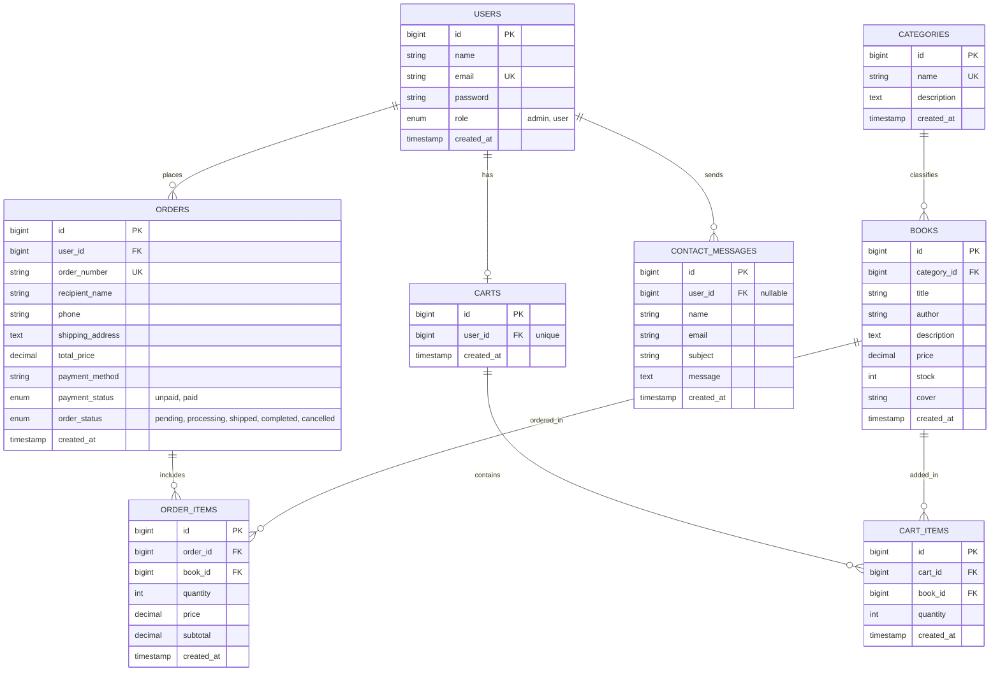

# DOKUMENTASI TEKNIS & PANDUAN ASESMEN BNSP
# Project: SudutBaca – Online Bookstore
> **Tagline**: "Temukan Bacaan Favoritmu."  
> **Konsep Desain**: Modern Minimalist, Warm, Natural, dan Elegant (Warm Green & Cream)  
### Sertifikasi Skema: Junior Web Developer (MUK)

---

## 1. IDENTITAS PROYEK
* **Nama Aplikasi**: SudutBaca – Online Bookstore
* **Tagline**: "Temukan Bacaan Favoritmu."
* **Palet Warna**: Warm Green & Cream (Forest Green `#315C46`, Warm Cream `#F8F5EC`, Sage Green `#789477`, Soft Beige `#E8DCC5`, Dark Brown `#463D32`)
* **Kategori**: Aplikasi Web E-Commerce Toko Buku Online
* **Skema Sertifikasi**: Junior Web Developer (BNSP)
* **Arsitektur**: Decoupled Client-Server (Single Page Application + RESTful API)

---

## 2. PENGANTAR DAN RUANG LINGKUP PROYEK

### 2.1 Latar Belakang Masalah
Kebutuhan akses terhadap literatur fisik yang berkualitas seringkali terkendala oleh sistem katalog toko buku konvensional yang tidak terpusat, ketidakpastian stok barang, serta proses pemesanan digital yang rumit. Selain itu, banyak calon pembeli yang enggan bertransaksi online karena keharusan menggunakan dompet digital atau kartu perbankan yang rentan risiko keamanan data pribadi.

SudutBaca hadir sebagai solusi toko buku online modern yang sederhana, transparan, dan terpercaya dengan sentuhan visual natural yang hangat dan menenangkan. Dengan metode pembayaran **Payment at Delivery (COD)**, pelanggan dapat memesan buku secara mudah dan melakukan pembayaran tunai langsung saat pesanan diserahkan oleh kurir di alamat tujuan.

### 2.2 Tujuan Aplikasi
1. Memfasilitasi pengguna untuk menelusuri katalog buku berdasar kategori, melakukan pencarian judul, dan mengecek ketersediaan stok secara real-time.
2. Memudahkan proses reservasi dan pemesanan buku melalui alur keranjang belanja dan formulir checkout yang ringkas.
3. Mengadopsi metode pembayaran *Payment at Delivery* (bayar di tempat) sesuai kisi-kisi uji kompetensi tanpa risiko kegagalan sistem pembayaran pihak ketiga.
4. Memberikan sarana manajemen toko bagi Administrator untuk mengelola katalog, kategori, stok barang, memverifikasi data pengguna, serta mengontrol status pengiriman pesanan.
5. Mendemonstrasikan penguasaan 6 Unit Kompetensi Standar BNSP bagi Junior Web Developer.

### 2.3 Batasan Masalah
1. Metode pembayaran eksklusif menggunakan **Payment at Delivery (COD)** tanpa integrasi payment gateway pihak ketiga (Midtrans, Xendit, Stripe, dll).
2. Perhitungan biaya ongkos kirim diset secara flat (Gratis Ongkir) untuk memfokuskan asesmen pada integritas logika transaksi backend dan UI.
3. Otentikasi sesi berbasis Bearer Token (Laravel Sanctum).
4. Dua hak akses peran pengguna: `admin` dan `user`.

### 2.4 Kebutuhan Fungsional Berdasarkan Aktor

#### A. Aktor Pelanggan (Customer / User)
1. **Pendaftaran Akun (Register)**: Mendaftarkan akun baru dengan nama, email unik, password yang di-hash (Bcrypt), dan konfirmasi password.
2. **Autentikasi (Login & Logout)**: Masuk ke dalam sistem menggunakan email dan password untuk mendapatkan token akses, serta keluar dari sesi.
3. **Eksplorasi Beranda & Katalog**: Menjelajahi daftar buku, melihat cover, harga, penulis, dan kategori.
4. **Pencarian Buku (Search)**: Menemukan buku spesifik berdasarkan kata kunci judul maupun nama penulis melalui query backend.
5. **Detail Informasi Buku**: Meninjau sinopsis lengkap, stok yang tersedia, dan memilih kuantitas yang ingin dibeli.
6. **Keranjang Belanja (Cart)**: Menambah buku, memperbarui kuantitas item, menghapus item, serta kalkulasi otomatis subtotal dan total harga belanja.
7. **Proses Checkout Transaksi**: Mengisi identitas penerima, nomor telepon, alamat pengiriman, dan mengonfirmasi pesanan menggunakan *Payment at Delivery*.
8. **Riwayat & Detail Pesanan**: Memantau daftar transaksi sebelumnya beserta nomor unik pesanan, rincian buku, dan status pesanan (*pending, processing, shipped, completed, cancelled*).
9. **Hubungi Admin**: Mengirim pesan pertanyaan atau kendala layanan melalui form pesan kontak.

#### B. Aktor Administrator (Admin)
1. **Dashboard Statistik**: Memantau metrik agregat toko secara real-time: total koleksi buku, total kategori, total pelanggan terdaftar, total pesanan masuk, pendapatan lunas, dan transaksi terbaru.
2. **Kelola Kategori (CRUD)**: Menambah, mengubah nama/deskripsi, menghapus, serta melihat jumlah buku pada setiap kategori.
3. **Kelola Buku (CRUD & Upload Cover)**: Menambah buku baru, mengubah judul, penulis, kategori, harga, stok, mengunggah file gambar cover ke storage server, dan menghapus buku.
4. **Kelola Pesanan Pelanggan**: Melihat semua pesanan masuk, memeriksa informasi penerima dan daftar buku yang dipesan, serta memperbarui siklus status pesanan (*Pending $\rightarrow$ Processing $\rightarrow$ Shipped $\rightarrow$ Completed / Cancelled*) dan status pembayaran.
5. **Kelola Pengguna**: Meninjau data pelanggan yang terdaftar di database beserta tanggal registrasi dan hak aksesnya.
6. **Tinjauan Pesan Masuk**: Membaca pesan kontak dari pengunjung/pelanggan dan menghapus pesan yang telah ditindaklanjuti.

---

## 3. DESAIN DATABASE & SKEMA RELASI (8 TABEL)

Aplikasi BookSpace menggunakan basis data **MySQL** dengan nama database `bookspace_db` yang ternormalisasi:



### Kamus Data Utama

| Nama Tabel | Primary Key | Foreign Key | Kolom Kunci & Tipe Data | Keterangan Bisnis |
|---|---|---|---|---|
| `users` | `id` (bigint) | - | `email` (varchar, unique), `password` (varchar, bcrypt), `role` (enum: 'admin', 'user') | Menyimpan akun pengguna dan administrator |
| `categories` | `id` (bigint) | - | `name` (varchar 100, unique), `description` (text) | Klasifikasi kategori pustaka |
| `books` | `id` (bigint) | `category_id` $\rightarrow$ `categories(id)` | `title` (varchar), `price` (decimal 12,2), `stock` (int unsigned), `cover` (varchar) | Data katalog buku dan ketersediaan stok fisik |
| `carts` | `id` (bigint) | `user_id` $\rightarrow$ `users(id)` | `user_id` (unique) | Keranjang belanja tunggal untuk tiap user aktif |
| `cart_items` | `id` (bigint) | `cart_id` $\rightarrow$ `carts(id)`, `book_id` $\rightarrow$ `books(id)` | `quantity` (int unsigned) | Relasi item buku di keranjang (composite unique) |
| `orders` | `id` (bigint) | `user_id` $\rightarrow$ `users(id)` | `order_number` (varchar unique), `total_price` (decimal), `payment_method`, `payment_status`, `order_status` | Master invoice transaksi pemesanan |
| `order_items` | `id` (bigint) | `order_id` $\rightarrow$ `orders(id)`, `book_id` $\rightarrow$ `books(id)` | `price` (decimal 12,2), `quantity` (int), `subtotal` (decimal 12,2) | Snapshot harga saat transaksi dibeli |
| `contact_messages`| `id` (bigint) | `user_id` $\rightarrow$ `users(id)` (nullable) | `name`, `email`, `subject`, `message` (text) | Pesan pertanyaan yang dikirimkan ke admin |

---

## 4. STRUKTUR FOLDER & MANAJEMEN KODE

Pemisahan tanggung jawab (*Separation of Concerns*) diterapkan secara ketat:
* `backend/`: Mengelola endpoint API, routing, request validation, business logic, ORM, database transaction, dan token hashing.
* `frontend/`: Mengelola visual components, client-side routing, user session state, cart state, dan HTTP communication.

```
bookstore/
│
├── backend/                             # PHP Laravel 10 REST API
│   ├── app/
│   │   ├── Http/
│   │   │   ├── Controllers/             # Logic controller modular
│   │   │   │   ├── AdminDashboardController.php
│   │   │   │   ├── AuthController.php
│   │   │   │   ├── BookController.php
│   │   │   │   ├── CategoryController.php
│   │   │   │   ├── CartController.php
│   │   │   │   ├── ContactController.php
│   │   │   │   └── OrderController.php
│   │   │   └── Middleware/
│   │   │       └── CheckRole.php        # Role-based Authorization Guard
│   │   └── Models/                      # Eloquent ORM Models & Relationships
│   │       ├── User.php
│   │       ├── Category.php
│   │       ├── Book.php
│   │       ├── Cart.php
│   │       ├── CartItem.php
│   │       ├── Order.php
│   │       ├── OrderItem.php
│   │       └── ContactMessage.php
│   ├── database/
│   │   ├── migrations/                  # 8 Skema tabel migrasi
│   │   └── seeders/                     # Seeder akun demo dan data awal
│   ├── routes/
│   │   └── api.php                      # 28 API routes
│   └── storage/app/public/books/        # Lokasi penyimpanan cover gambar buku
│
├── frontend/                            # ReactJS + Vite SPA
│   ├── src/
│   │   ├── components/                  # Navbar, Footer, BookCard, StatusBadge
│   │   ├── context/                     # AuthContext, CartContext (State Management)
│   │   ├── layouts/                     # MainLayout (User) & AdminLayout (Sidebar)
│   │   ├── pages/
│   │   │   ├── user/                    # Home, Books, Detail, Cart, Checkout, Orders, Contact
│   │   │   └── admin/                   # Dashboard, Categories, Books, Orders, Users, Messages
│   │   ├── routes/                      # AppRoutes & ProtectedRoute Guards
│   │   ├── services/                    # Axios Client Instance (Bearer Token Interceptor)
│   │   ├── App.jsx
│   │   ├── main.jsx
│   │   └── index.css                    # Styling Modern Minimalist Bookstore
│   ├── package.json
│   └── vite.config.js
│
├── documentation/                       # Berkas Dokumentasi Teknis BNSP
│   ├── DOKUMENTASI_TEKNIS_BNSP.md       # Dokumen ini
│   └── PANDUAN_PRESENTASI_SLIDE.md      # Panduan menyusun 8 slide asesmen
├── test_e2e_http.js                     # Skrip otomatis uji kelayakan live API
└── README.md                            # Panduan instalasi dan pengujian cepat
```

---

## 5. SPESIFIKASI REST API LENGKAP

Seluruh respons API mengembalikan format JSON standar:
```json
{
  "success": true,
  "message": "Pesan status operasi",
  "data": { ... }
}
```

### Ringkasan 28 Endpoint API

| No | Modul | Method | Endpoint URL | Autentikasi / Guard | Deskripsi Singkat |
|---|---|---|---|---|---|
| 1 | Auth | `POST` | `/api/register` | Public | Mendaftarkan akun user baru |
| 2 | Auth | `POST` | `/api/login` | Public | Login dan memperoleh Bearer Token Sanctum |
| 3 | Auth | `POST` | `/api/logout` | `auth:sanctum` | Menghapus token aktif / keluar sesi |
| 4 | Auth | `GET` | `/api/me` | `auth:sanctum` | Mendapatkan data akun pengguna saat ini |
| 5 | Katalog | `GET` | `/api/categories` | Public | Menampilkan semua kategori dan jumlah buku |
| 6 | Katalog | `GET` | `/api/categories/{id}` | Public | Detail 1 kategori beserta bukunya |
| 7 | Katalog | `GET` | `/api/books` | Public | Menampilkan daftar buku (+ search & filter) |
| 8 | Katalog | `GET` | `/api/books/{id}` | Public | Menampilkan detail lengkap 1 buku |
| 9 | Keranjang | `GET` | `/api/cart` | `auth:sanctum` | Menampilkan keranjang belanja user |
| 10 | Keranjang | `POST` | `/api/cart/items` | `auth:sanctum` | Menambahkan buku ke dalam keranjang |
| 11 | Keranjang | `PUT` | `/api/cart/items/{id}` | `auth:sanctum` | Memperbarui kuantitas item (+ / -) |
| 12 | Keranjang | `DELETE`| `/api/cart/items/{id}` | `auth:sanctum` | Menghapus item dari keranjang |
| 13 | Transaksi | `POST` | `/api/checkout` | `auth:sanctum` | Checkout atomik (Payment at Delivery) |
| 14 | Transaksi | `GET` | `/api/orders` | `auth:sanctum` | Daftar riwayat pesanan milik sendiri |
| 15 | Transaksi | `GET` | `/api/orders/{id}` | `auth:sanctum` | Detail pesanan tertentu |
| 16 | Kontak | `POST` | `/api/contact` | Public / Auth | Mengirim pesan kontak ke admin |
| 17 | Admin | `GET` | `/api/admin/stats` | `role:admin` | Statistik agregat untuk dashboard |
| 18 | Admin | `GET` | `/api/admin/users` | `role:admin` | Menampilkan seluruh pengguna terdaftar |
| 19 | Admin | `POST` | `/api/admin/categories` | `role:admin` | Menambah kategori baru |
| 20 | Admin | `PUT` | `/api/admin/categories/{id}` | `role:admin` | Mengubah nama/deskripsi kategori |
| 21 | Admin | `DELETE`| `/api/admin/categories/{id}` | `role:admin` | Menghapus kategori |
| 22 | Admin | `POST` | `/api/admin/books` | `role:admin` | Tambah buku (+ upload cover gambar) |
| 23 | Admin | `POST` | `/api/admin/books/{id}` | `role:admin` | Update data buku (+ ganti cover) |
| 24 | Admin | `DELETE`| `/api/admin/books/{id}` | `role:admin` | Hapus buku dari katalog |
| 25 | Admin | `GET` | `/api/admin/orders` | `role:admin` | Menampilkan seluruh pesanan toko |
| 26 | Admin | `PATCH` | `/api/admin/orders/{id}/status` | `role:admin` | Mengubah status pesanan & pembayaran |
| 27 | Admin | `GET` | `/api/admin/messages` | `role:admin` | Melihat pesan masuk dari pelanggan |
| 28 | Admin | `DELETE`| `/api/admin/messages/{id}` | `role:admin` | Menghapus pesan kontak |

---

## 6. ALUR LOGIKA PENTING & POTONGAN KODE (CODE HIGHLIGHTS)

### 6.1 Database Transaction & Atomic Checkout (`OrderController.php`)
Poin krusial yang dinilai asesor adalah: *Bagaimana sistem memastikan integritas stok dan pencatatan transaksi jika terjadi gangguan di tengah proses checkout?*

```php
// backend/app/Http/Controllers/OrderController.php
public function checkout(Request $request)
{
    $validated = $request->validate([
        'recipient_name' => 'required|string|max:255',
        'phone' => 'required|string|max:30',
        'shipping_address' => 'required|string',
    ]);

    $user = $request->user();
    $cart = Cart::where('user_id', $user->id)->with('items.book')->first();

    if (!$cart || $cart->items->isEmpty()) {
        return response()->json(['success' => false, 'message' => 'Keranjang kosong.'], 422);
    }

    // MEMULAI TRANSAKSI ATOMIK (ACID)
    DB::beginTransaction();

    try {
        $totalPrice = 0;
        $itemsToCreate = [];

        foreach ($cart->items as $cartItem) {
            // Lock baris buku secara pesimis untuk mencegah race condition stok
            $book = Book::lockForUpdate()->find($cartItem->book_id);

            if ($book->stock < $cartItem->quantity) {
                throw new \Exception("Stok buku '{$book->title}' tidak mencukupi (tersisa {$book->stock}).");
            }

            $subtotal = $book->price * $cartItem->quantity;
            $totalPrice += $subtotal;

            $itemsToCreate[] = [
                'book' => $book,
                'quantity' => $cartItem->quantity,
                'price' => $book->price,
                'subtotal' => $subtotal,
            ];
        }

        // 1. Simpan Master Order
        $order = Order::create([
            'user_id' => $user->id,
            'order_number' => 'ORD-' . date('Ymd') . '-' . strtoupper(Str::random(6)),
            'recipient_name' => $validated['recipient_name'],
            'phone' => $validated['phone'],
            'shipping_address' => $validated['shipping_address'],
            'total_price' => $totalPrice,
            'payment_method' => 'Payment at Delivery',
            'payment_status' => 'unpaid',
            'order_status' => 'pending',
        ]);

        // 2. Simpan Detail Item & Kurangi Stok Buku Secara Real
        foreach ($itemsToCreate as $itemData) {
            OrderItem::create([
                'order_id' => $order->id,
                'book_id' => $itemData['book']->id,
                'quantity' => $itemData['quantity'],
                'price' => $itemData['price'],
                'subtotal' => $itemData['subtotal'],
            ]);

            $itemData['book']->decrement('stock', $itemData['quantity']);
        }

        // 3. Bersihkan Keranjang Belanja User
        $cart->items()->delete();

        // Commit seluruh operasi
        DB::commit();

        return response()->json([
            'success' => true,
            'message' => 'Pesanan berhasil dibuat! Pembayaran dilakukan saat buku diterima (Payment at Delivery).',
            'data' => $order->load(['items.book']),
        ], 201);

    } catch (\Exception $e) {
        // Rollback otomatis jika ada error (stok tidak berkurang, order tidak tersimpan setengah)
        DB::rollBack();
        return response()->json(['success' => false, 'message' => $e->getMessage()], 422);
    }
}
```

### 6.2 Role Middleware Authorization (`CheckRole.php`)
Menjamin endpoint khusus admin tidak dapat dieksploitasi oleh pengguna biasa:

```php
// backend/app/Http/Middleware/CheckRole.php
public function handle(Request $request, Closure $next, string $role): Response
{
    $user = $request->user();

    if (!$user) {
        return response()->json(['success' => false, 'message' => 'Unauthenticated.'], 401);
    }

    if ($user->role !== $role) {
        return response()->json(['success' => false, 'message' => 'Unauthorized. Akses ditolak.'], 403);
    }

    return $next($request);
}
```

### 6.3 Interceptor Axios pada Frontend (`frontend/src/services/api.js`)
Otomatis menginjeksi Bearer token ke setiap request yang membutuhkan autentikasi:

```javascript
// frontend/src/services/api.js
api.interceptors.request.use((config) => {
  const token = localStorage.getItem('bookspace_token');
  if (token) {
    config.headers.Authorization = `Bearer ${token}`;
  }
  return config;
});
```

---

## 7. MATRIKS PEMENUHAN 6 UNIT KOMPETENSI BNSP

| Kode Unit | Judul Unit Kompetensi | Bukti Implementasi Konkret pada BookSpace |
|---|---|---|
| **J.620100.005.02** | Mengimplementasikan user interface | Antarmuka Customer responsif (Navbar, Hero, Grid Buku, Form Checkout, Status Badge) dan Dashboard Admin terpisah (Sidebar navigasi, Kartu metrik, Tabel CRUD). |
| **J.620100.010.01** | Menerapkan perintah eksekusi bahasa pemrograman berbasis teks, grafik, dan multimedia | Pemrograman PHP (Laravel 10), JavaScript modern (ES6+, JSX), semantic HTML5, styling CSS variabel, serta penanganan upload dan rendering cover gambar buku. |
| **J.620100.015.01** | Menyusun fungsi, file atau sumber daya pemrograman yang lain dalam organisasi yang rapi | Struktur direktori bersih: pemisahan `backend/` dan `frontend/`, Controller modular, Model Eloquent, Reusable Components React, dan State Management Context terpusat. |
| **J.620100.016.01** | Menulis kode dengan prinsip sesuai guidelines dan best practices | Naming conventions rapi, validasi input ketat (Form Validation), sanitasi input, password hashing (Bcrypt), dan HTTP Status Codes standar REST (200, 201, 401, 403, 404, 422). |
| **J.620100.017.02** | Mengimplementasikan pemrograman terstruktur | Penerapan *Separation of Concerns* (Router $\rightarrow$ Middleware $\rightarrow$ Controller $\rightarrow$ Model $\rightarrow$ DB Transaction). Logika transaksi tidak tercampur di tampilan view. |
| **J.620100.019.02** | Menggunakan library atau komponen pre-existing | Memanfaatkan framework Laravel 10, Laravel Sanctum, ReactJS, Vite, React Router Dom, Axios HTTP Client, dan ikon Lucide-React. |

---

## 8. AKUN DEMO PENGUJIAN & PANDUAN DEMO ASESOR

### 8.1 Akun Uji Coba

1. **Akun Administrator**:
   * Email: `admin@bookspace.com`
   * Password: `password123`
   * Role: `admin`
   * Hak Akses: Dashboard Ringkasan, Kelola Kategori, Kelola Buku & Cover, Kelola Pesanan (Update Status), Kelola Pengguna, Tinjau Pesan.

2. **Akun Customer (Demo Budi)**:
   * Email: `budi@gmail.com`
   * Password: `password123`
   * Role: `user`
   * Hak Akses: Eksplorasi Katalog, Tambah ke Keranjang, Checkout Payment at Delivery, Riwayat Pesanan Saya, Hubungi Admin.

*(Tersedia tombol satu-kali klik **Demo Akun Cepat** pada halaman Login `/login` untuk mempermudah demonstrasi langsung di hadapan asesor)*.

### 8.2 Skenario Urutan Demonstrasi di Hadapan Asesor

1. **Langkah 1: Menunjukkan Halaman Utama (Beranda)**
   - Buka `http://localhost:5173/`. Tunjukkan hero section, keunggulan toko, kategori pilihan, dan grid buku terbaru.
2. **Langkah 2: Melakukan Pencarian Buku**
   - Buka `/books`, ketik kata kunci "React" atau "Bisnis" di kotak pencarian. Tunjukkan bagaimana buku difilter secara cepat melalui backend.
3. **Langkah 3: Demonstrasi Akun Pelanggan (Login & Keranjang)**
   - Buka `/login`, klik tombol **Akun Customer**, lalu klik **Masuk Sekarang**.
   - Buka detail buku (misal: *Mastering React*), atur kuantitas menjadi 2, klik **Masukkan Keranjang**.
   - Buka `/cart`, ubah kuantitas menggunakan tombol (+ / -), tunjukkan subtotal dan total harga terhitung secara otomatis.
4. **Langkah 4: Proses Checkout COD (Payment at Delivery)**
   - Klik **Lanjutkan ke Checkout**.
   - Tunjukkan formulir alamat pengiriman dan perhatikan pesan bahwa metode terkunci pada *Payment at Delivery*.
   - Klik **Konfirmasi & Buat Pesanan**.
   - Sistem mengarahkan ke halaman detail pesanan (`/orders/{id}`) dengan nomor pesanan unik (contoh: `ORD-20261117-XXXXXX`), status pesanan `Pending`, dan status pembayaran `Belum Bayar (COD)`.
5. **Langkah 5: Mengirim Pesan Kontak**
   - Buka `/contact`, isi formulir pesan, dan kirimkan. Tunjukkan alert notifikasi sukses berwarna hijau.
6. **Langkah 6: Demonstrasi Akun Administrator**
   - Logout dari akun Budi. Masuk kembali di `/login` dan klik tombol **Akun Admin**.
   - Buka `/admin/dashboard`. Jelaskan 4 kartu metrik (Total Buku, Kategori, Pengguna, Pesanan) yang diambil langsung dari database.
   - Buka `/admin/orders`. Tunjukkan pesanan yang baru saja dibuat oleh Budi.
   - Klik tombol **Ubah Status** (ikon pensil), ganti status pesanan dari `Pending` $\rightarrow$ `Completed`. Jelaskan bahwa status pembayaran otomatis berubah menjadi `Paid` (Lunas) karena barang telah diterima pelanggan.
   - Buka `/admin/categories`. Tambah satu kategori baru, tunjukkan kategori langsung bertambah di tabel.
   - Buka `/admin/messages`. Tunjukkan pesan yang tadi dikirimkan oleh customer tersimpan dengan rapi.
